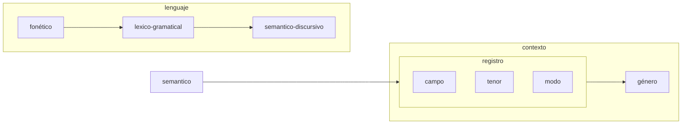
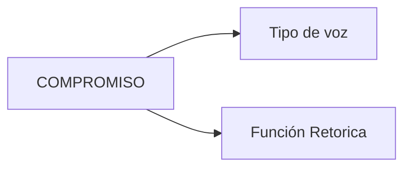
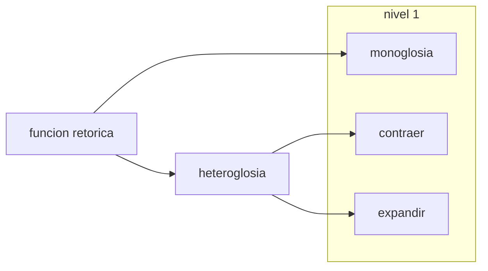
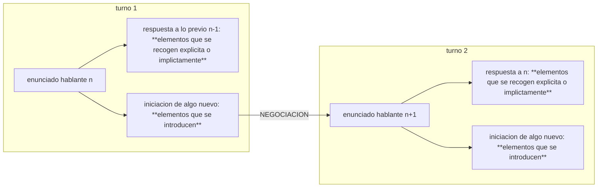
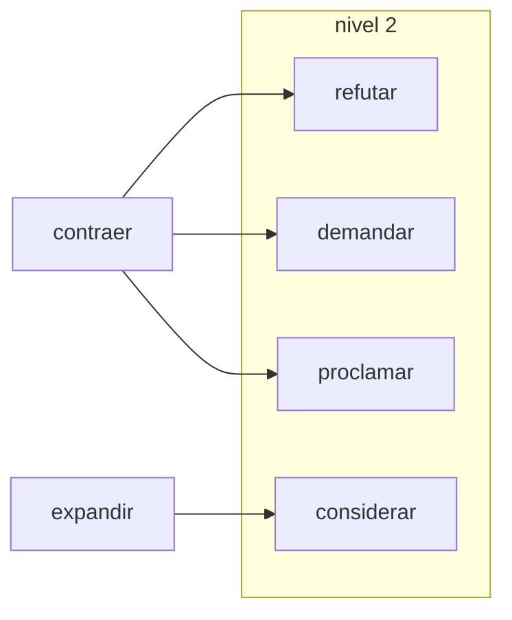
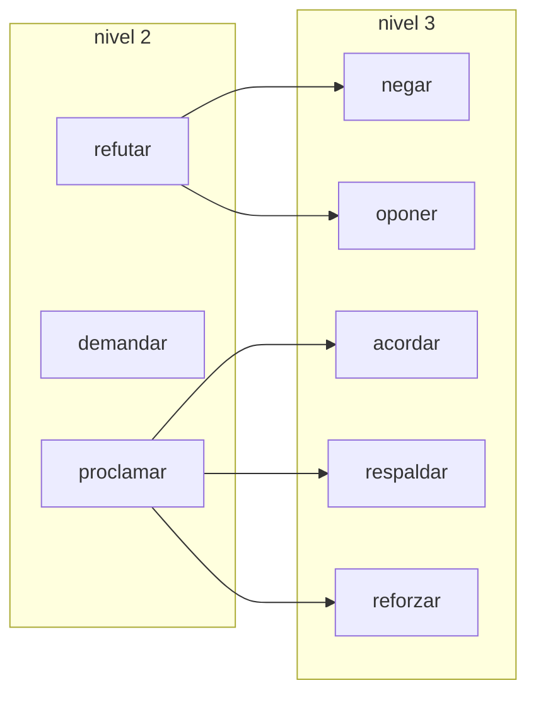
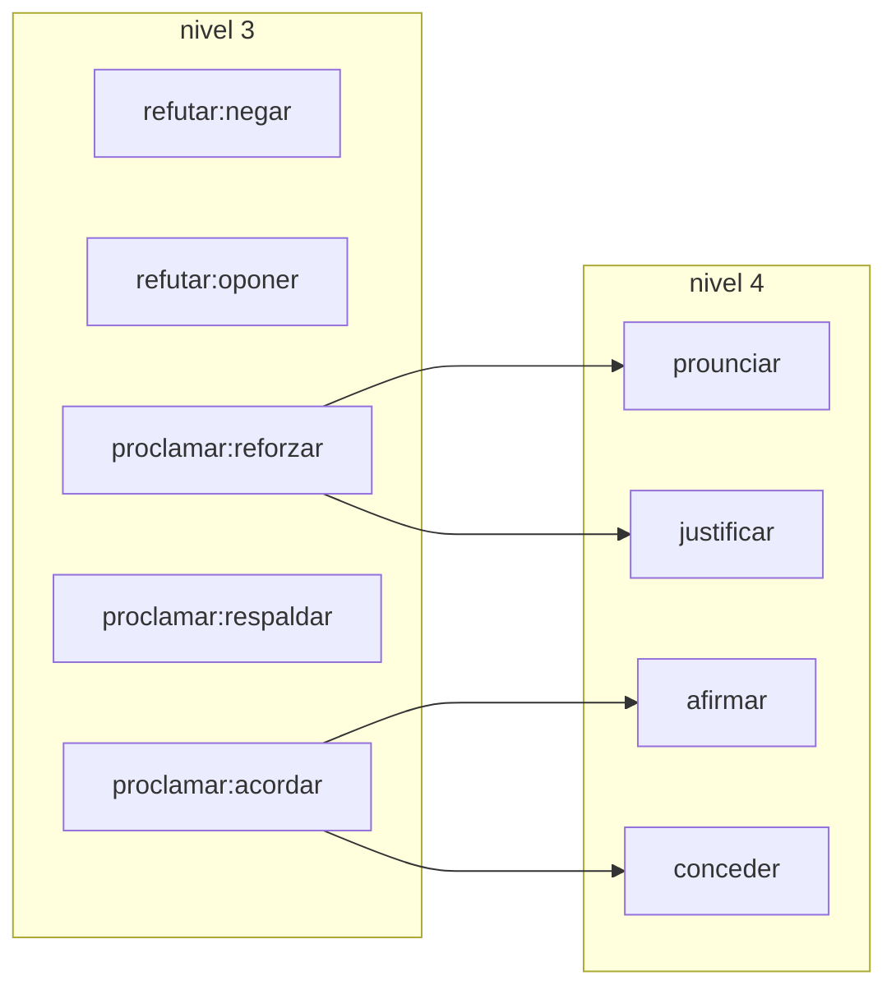
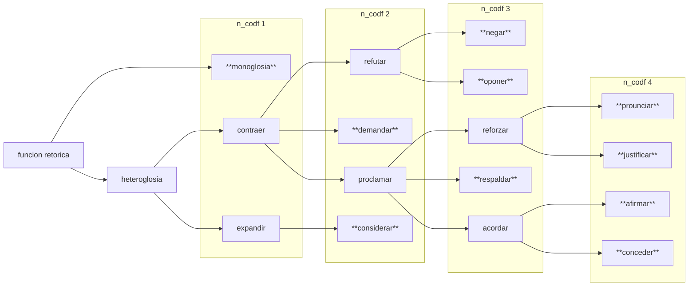

# Manual de Codificacion Estudio 2

Este manual sirve de Introducción a aspectos generales de la Ligüistica Sistémico Funcional (a partir de ahora: LSF) y al sistema de codificación que se usará para el proyecto

Es importante tener en consideración que este manual está orientado a orientar en la codificación de una tesis doctoral de psicología. La LSF es un modelo teórico muchísimo más amplio de lo que aquí se presenta, en este texto solo nos enfocaremos en una pequeñísima parte de este, y en función de los objetivos centrales de la tesis.

>[!NOTE]
> Los objetivos de esta tesis no serán explicados en detalle, ya que esto puede sesgar la codificación. Es importante que los asistentes no tengan conocimientos de ello, en tanto esto puede empujar a privilegiar ciertos códigos por sobre otros. Para mí como investigador es importante que haya otra persona codificando de modo de tener un punto de comparación,que me permita también revisar criticamente mis propios sesgos en la codificación.

Objetivo de Aprendizaje:

-   Reconocer los principios generales de la Teoría Lingüistica Sistémico Funcional.
-   Identificar las categorías analíticas específicas que serán utilizadas en el sistema de codificación Lingüistica Sistémico Funcional.
-   Describir un texto en base a las categorías análiticas de la Lingüistica Sistémico Funcional.
-   Analizar diferencias entre textos en base a las categorías análiticas de la Lingüistica Sistémico Funcional. 

## LECTURAS RECOMENDADAS

Hay muchos elementos de la LSF que no van a poder ser abordados en este manual, por lo tanto **leer los siguientes textos introductorios primero.** Están ordenados siguiendo en una secuencia de creciente especificidad. Por lo tanto recomiendo encarecidamente leerlos en el orden que se presentan

Todos los textos que se recomiendan pueden encontrarse <!--[aqui](https://drive.google.com/drive/folders/1pWMyKpSVkNSnL8bgZwiQ9-xjFY5rohHK?usp=sharing)-->

>[!NOTE] 
> Los textos están anotados con mis comentarios, asi que ignoren si ven alguna tontera entre ellos.
> A lo largo del manuel iré agregando links a textos, no es necesario leer todos. Concentrarse en estos primeros 4. Los otros queda a criterio e interés de cada cual.

**1**. Sección 1.3 (pp.20-31) del Capítulo 1 del libro "Halliday's Introduction to Functional Grammar" de Halliday & Matthiesen (2013)

Esta sección introduce los conceptos centrales que se deben entender la LSF para lo que se hablará en el manual. Centrarse especialmente en los siguientes conceptos:

-   Estratificación: Comprender el lenguaje como un sistema organizado en niveles de abstracción socio-semiótica: Contexto $\leftrightarrow$ Semántica $\leftrightarrow$ Lexicogramática $\leftrightarrow$ Fonología/Grafología8.\
-   Instanciación: Comprender la relación de generalización entre el sistema (el potencial global de significado) y el texto (la elección concreta en uso).
-   Relaciones paradigmáticas (Sistema vs. Estructura): Comprender el eje del sistema como el conjunto de opciones contrastivas ("lo que se puede decir en lugar de otra cosa") expresadas técnicamente mediante redes sistémicas
-   Diferencias entre metafunciones: Reforzar sus diferencias, y su simultaneidad metafuncional al interior de una misma cláusula (partes de una oración para quienes no somos lingüistas)

**2**.Capitulo de Introduccion del libro "The Language of Evaluation" de Martin & White (2005). Llegar hasta página 34, justo antes de empezar sección 1.4

Al igual que el anterior es un capítulo introductorio, pero más centrado en un estrado semántico discursivo. Enfocarse en que quede claro lo siguiente:

-   Revisión de las metafunciones desde la semántica discursiva: Identificar cómo el significado evaluativo trasciende los límites de una sola cláusula para desplegarse prosódicamente a lo largo del texto
-   Relaciones paradigmáticas en la semántica interpersonal: Comprender cómo los recursos evaluativos se organizan en paradigmas y matrices de elección contrastiva (por ejemplo, valores de probabilidad, orientación subjetiva u objetiva y grados de delicadeza)
-   Estrato Semántico-Discursivo: ¿Qué lo diferencia, que aporta este nivel de análisis?

**3**. "Appraisal" de Hood (2019). Capitulo 15 del libro: The Cambridge Handbook of Systemic Functional Linguistics

Se introduce más en detalle en el sistema de VALORACION (appraisal) que será el foco de la codificación y de este manual. Hay elementos que este capítulo no tiene, debido a que no tiene los desarrollos más recientes
De este texto es particularmente importante enfocarse en los siguiente

-   ¿Qué es el subsistema de Actitud?
-   ¿Qué es el subsistema de Compromiso (engagement)?
-   ¿Qué es el subsistema de Gradación (gradation)?
-   Diferencias entre actitud evocada e inscrita.

>[!NOTE] 
> Toda la terminología acá puede marear, más adelante se presentará de una forma un poco mas ordenada. Por lo pronto enfocarse en entender las diferencias entre esos 3 subsistemas.

**4**. "El sistema de valoración como herramienta teórico-metodológica para el estudio social e ideológico del discurso" de Oteíza y Pinuer (2019) Este artículo lleva lo revisado hasta ahora el español, además de introducir algunas propuestas al sistema de actitud

Acá enfocarse en lo siguiente:

-   Reforzar diferencias entre Actitud, Compromiso y Gradación ahora con ejemplos en español
-   Categorías de apreciación para evaluación de eventos, procesos y situaciones sociales

---

## TEORIA

Si bien las lecturas anteriores van a aportar una mejor introducción a cualquier cosa que yo pueda hacer, hay algunas cosas que me interesa reforzar en tanto van a ser importantes de tener en mente para entender la codificación que se hará. Además se agregarán algunos otros antecedentes teóricos que no están incluidos en las lecturas anteriores, pero que aportan información adicional para entender algunas particularidades del discurso hablado.

**Consideracciones importantes sobre estratificación**

Tal y como se revisó en los textos un principio básico de la LSF es que el lenguaje se ordena en distintos estratos de distintos niveles de abstracción, los patrones en cada uno de estos estratos se organiza de la siguiente manera:

La codificación que haremos está fundamentalmente centrado en el estrato Semántico-Discursivo. Sin embargo, hay elementos que se dan a nivel léxicogramatical que pueden ayudar a entender mejor qué está sucediendo a nivel semántico. Veamos las situientes frases:

> [!EXAMPLE] 
>- "Se debe privilegiar el acuerdo" -> Usa el clítico "se"", puede incluir o no al hablante. El actor queda indeterminado y difumina la responsabilidad, proyectando una necesidad normativa/institucional. 
>- "Debemos privilegiar el acuerdo" -> Usa voz personal, se entiende que el hablante está incluido en la demanda. Invita a la solidaridad. 
>- "El acuerdo debe ser privilegiado" -> Acá el foco se vuelve el acuerdo, no el agente que privilegia. La demanda se naturaliza sobre la entidad misma, reduciendo el margen para la disidencia al invisibilizar la agencia humana.
>
> En estos ejemplos se repite la idea de una obligación (modulación) con el verbo deber. Sin embargo, las distintas elecciones en el estrato lexicogramatical (cómo se articulan Actor, Meta y Tema) generan diferencias en el estrato semántico-discursivo y en la metafunción interpersonal.
>
> Lo que a su vez configura (y es configurado por) contextos distintos. 
>¿Por qué decimos que: configura y es configurado por? Porque si bien ciertos contextos pueden promover instanciaciones como la primera, siempre puede ser que alguien "elija" la segunda, lo que a su vez puede modificar el tenor de la conversación.

---

**Consideraciones sobre las metafunciones**

La simultaneidad de las metafunciones implica que nunca operan una sola. Sin embargo, no por ello debemos olvidar que cada una de estas aporta a configurar el registro desde "lados" distintos. Cada metafunción se realiza (típicamente) en el registro a través de una variable: la textual en el modo, la interpersonal en el tenor, la ideacional en el campo. Típicamete por que la relación no es mecánica, el tenor también se podría realizar a través de significados textuales e ideacionales

- **METAFUNCIÓN TEXTUAL:** Organización del mensaje como texto

**¿De qué manera la organización del mensaje configura el texto y su modo de circulación?** $\rightarrow$ Nos puede hablar de diferencias en la metafunción textual (y esto a su vez en el modo del registro). 
>[!EXAMPLE] Es distinta una discusión que se tiene en vivo a una que se tiene en los comentarios del Emol. Ambas son discusiones, pero adoptan formas distintas. 
>También es distinto responder "Al weón no le digai nada" que "No le digai nada al weón": lo que se pone primero organiza el mensaje de otro modo.

- **METAFUNCIÓN INTERPERSONAL:** Relaciones entre participantes de un acto comunicativo

**¿De qué manera lo que se dice posiciona al hablante y configura el tipo de relación que se establece con otros?** $\rightarrow$ Nos puede hablar de diferencias en la metafunción interpersonal (y esto a su vez en el tenor del registro) 
>[!EXAMPLE] Es distinto plantear el uso del clítico "se debe" a usar el "debemos"

- **METAFUNCIÓN IDEACIONAL:** Experiencia humana

**¿De qué manera lo que se dice construye lo que se está haciendo?** $\rightarrow$ Nos puede hablar de diferencias en la metafunción ideacional (y esto a su vez en el campo del registro) 
>[!EXAMPLE] Es distinto plantear una actividad como una lucha ideológica o como un acto de trolleo, aun cuando el resultado final sea el mismo: cambian los procesos y participantes que se seleccionan para construir el evento.

Si bien podemos separar estas metafunciones, queda claro que se influyen mutuamente. Una persona trolleando en la sección de comentarios de Emol probablemente va a actuar de forma distinta a alguien en la vida real para quién discutir tiene un matiz de lucha ideológica. Un dicho común es que una forma de perder frente a un troll es personalizar los ataques, es decir, el trolleo, por ejemplo, funciona en tanto es capaz de instaurar cierto vínculo interpersonal pero esto también es facilitado de formas distintas según el modo en que se da (es distinto en cara-a-cara que online)

---

**Consideraciones sobre discurso hablado**

La mayoría de lo que se ha visto hasta acá, incluido los textos recomendados, están centrados en el análisis de texto escrito. Sin embargo, lo que vamos a analizar es discurso oral. El discurso oral obviamente tiene diferencias importantes con el escrito, por lo que haré un breve repaso de elementos a tener en cuenta. Al final de esta sección agregaré una serie de textos recomendados y por qué.
Las conversaciones están organizadas en torno a **turnos de habla**  (más adelante veremos otros modos de dividir el discurso). Durante estos turnos las personas adoptar y negocian roles: entregan y solicitando información, bienes y servicios.
Es decir, hay una dinámica de intercambio entre un turno y otro. En base a esto White y Rose (2007) proponen 13 funciones distintas que se realizan en la interacción entre hablantes (que también podría ser entre dos personas hablándose por chat)

| |iniciar | responder | 
| ---| ---| ---| 
|**Entregar** informacion| afirmacion | reconocimiento | 
|**Solicitar** informacion | pregunta| respuesta| 
| **Entregar** bienes y servicios| ofrecimiento | aceptar | 
|**Solicitar** bienes y servicios |solicitar | compliance | 

A estas 8 funciones se le pueden sumar 5 más
- Saludo (¡Hola!) y Respuesta a saludo (¿Qué tal?)
- Llamado (¡Oye!) y respuesta a llamado (¿si?)
- Exclamaciones (¡Ahhh!)

Cada uno de estos actos implica adoptar un rol y asignarle un rol a otro que puede o no puede ser aceptado. Por eso es que a este sistema se le llama sistema de NEGOCIACIÓN.

Si bien no vamos a codificar dicho sistema, tratar de siempre tener en el fondo de la cabeza la siguiente pregunta **¿Esta persona está entregando o solicitando algo?**

Tipicamente la solicitud se realiza a través de una pregunta, y las afirmaciones a través de aserciones. Estas formas "típicas" se llaman **formas congruentes** ¡Pero no siempre es así!

>[!EXAMPLE] Digamos que quiero que alguien me pase una cerveza.
>La forma congruente seria una solicitud con una pregunta "¿Me pasas una chela?"
>Pero puedo solicitar lo mismo de forma indirecta "Uuuy, me encantaría una cerveza"
>O a través de un imperativo: ¡Pásame una chela!
>

En cada uno de estos ejemplos solicito lo mismo, pero el tipo de relación que se establece con el oyente es muy distinta.
A estas formas de realizar ciertas clausulas de forma no congruente se le llama **metáfora gramatical** y son muy útiles en tanto nos hablan del MODO (MOOD) el cual es el sistema que analiza la metafunción interpersonal a nivel lexiogramatical.

>[!EXAMPLE] Un caso más extremo al anterior, es como puedo mostrar desacuerdo con alguien incluso a través de preguntas retóricas
> "No creo que estes en lo correcto" vrs "¿De verdad crees que estás en lo correcto?" 
> Dependiendo del tono en que se haga la pregunta puede ser que realmente este preguntandole a la otra persona eso, o que en verdad sea una pregunta retórica que dé cuenta de que no le creo

>[!INFO] Algunos textos recomendados e caso que se quiera profundizar en esto son
>
>- Linell - Approaching Dialogue Talk
>- Eggins & Slade - Analysung Casual Conversatio
>

**Modos de división del discurso**

Las presentamos desde el "corte" más pequeño que se puede a una unidad de discurso hastas la más global. Por lo general distintas divisiones están al servicio de análisis estratales distintos. Un análisis semántico discursivo no puede limitarse a un análisis clausular, pero sin duda el análisis clausular puede dar insights de elementos semánticos discursivos. No todas estas categorías son propias de la LSF, pero son utiles para poder entender cómo organizar y dividir el discurso hablado.
Es muy probable que para el análisis de las conversaciones que se hará sea suficiente con entender bien la diferencia hasta Turno de habla.

- **1.Cláusula** :  Unidad mínima de análisis en el discurso, con una estructura sintáctica completa (sujeto, predicado, etc.). Es la base de todo lo que viene después

>[!Example] "El gobierno implementó nuevas políticas educativas". Esta es una cláusula material (el sujeto es un actor que realiza una meta).

 El sistema de TRANSITIVIDAD está orientado al análisis lexiogramatical que permite diferenciar distintos tipos de cláusulas, en función de las formas de representar la experiencia (función ideacional). Esto no es necesario de aprender para esta codificación pero si es posible recomiendo encarecidamente revisar este texto introductorio de <!--[Quiroz(2023)](https://www.scielo.cl/scielo.php?script=sci_arttext&pid=S0718-93032023000100529)--> que explica los componentes de una cláusula
 
 Podemos identificar 6 tipos de procesos 
 
| Proceso 	| Descripcion 	| Participante|Proceso|
|---|---|---|---|
|Mental|De pensar, sentir, percibir|Experimentante|Fenómeno|
|Material|De hacer/ocurrir|Actor|Meta|
|Existencial|De existir/estar|Existente|-|
|Conductual|De comportarse|Conductante|Conducta|
|Verbal|De decir/comunicar|Decidor|Lo dicho|
|Relacional|De ser/estar siendo (como estado)|Portador|Atributo|
	  
- **2.Complejo Clausular** :Conjunto de cláusulas relacionadas entre sí, ya sea por subordinación, coordinación o anáfora. En LSF, estos complejos pueden reflejar jerarquías de significado (ej.: cláusulas subordinadas que modifican o amplían el sentido de una cláusula principal).
 
 >[!Example] "El gobierno implementó nuevas políticas educativas porque busca reducir la desigualdad" (cláusula principal + cláusula subordinada causal)
 
- **3.Movimiento discursivo**: Segmento del discurso que cumple una función retórica o discursiva

Se le puede conceptualiar de distintas formas. En Eggins y Slade(1997): "*a unit which speaker change could occur without turn transfer being seen as an interruption*” (p.186). El movimiento como unidad de análisis busca identificar funciones discursivas. La noción de función discursiva es una derivada de los tipos de intercambio y roles presentes en el lenguaje (NEGOCIACION).
Estas autoras usan criterios gramaticales (que la clausula sea independiente de cualquier otra clausula) y prosódicos (por ejemplo el silencio al terminar de hablar, entonaciones hacia el final del enunciado) para identificar cuando empieza y termina un movimiento

>[!EXAMPLE]
> - Patricia: Gusto en conocerlos   -> Respuesta a saludo (movimiento 1)
> - Patricia: Ya, oye, el tiempo corre y tenemos como 4 minutos. Veamos las fotos que nos dejaron acá en la mesa. -> Hace una solicitud (movimiento 2)
> - Patricia: La primera foto esta medio brígida -->Entrega información (movimiento 3)

En el ejemplo anterior Patricia podría haber dejado de hablar en cualquier momento de los 3 movimientos. Cada uno se entiende por si mismo, cada uno realiza una función distinta

>[!TIP]
>Un truco para determinar cuando termina un movimiento independiente (al margen que pueda haber mas de una en mismo turno) es agrega "o no?" al final.
>Esto técnicamente se dice "a move that can be tagged" 
> - Turno1: "Trajiste el pollo a la casa, o no?"
> - Turno2: m1 "Ahi esta, o no?" m2"Ahora podemos cocinarlo, o no?"
> Hay excepciones para esta reglas. En particular en exlamaciones o saludos

En el contexto de un estudio de las prácticas de argumentación colectiva <!--[Nuñez y Oyadenel (2009)](https://drive.google.com/file/d/1K4vy0euKa1OYVqnJZSKmpBvPPYSTGR8P/view?usp=sharing)--> desarrollan una tipología de 16 movimientos basada en la presencia o no de seis elementos binarios, para la clasificación de funciones en el marco de una tarea conjunta:
- Expresa/No expresa acuerdo con una opinión
- Introduce/No introduce nueva información a una opinión 
- Implica/No implica toma de postura frente a una opinión
- Introduce/No introduce nuevo tema en la conversación 
- Se orienta/No se orienta al(los) interactuantes
- Reacciona/No reacciona a un movimiento anterior de otro participante.

- **4.Turno de habla** : Contribución individual de un participante en la conversación, delimitada por pausas, interrupciones o marcadores conversacionales. En el análisis de conversaciones (Eggins y Slade), un turno puede contener uno o varios movimientos discursivos.

>[!EXAMPLE] En el ejemplo anterior los tres movimientos de Patricia son un solo turno de habla

- **5.Episodio**: Segmento del discurso organizado alrededor de un tópico o tema central, que incluye tanto el contenido proposicional como los procedimientos conversacionales que lo organizan. Un episodio puede contener múltiples turnos y movimientos discursivos, pero comparte una coherencia temática y participativa

El episodio se define por su tema central, pero también por cómo los participantes lo abordan (ej.: turnos que introducen, desarrollan o cierran el tema).

>[!EXAMPLE] Personas discutiendo sobre un tiktok que vieron

- **6.Etapa y Fase** : Los género discursivos son definidos por la LSF por una serie de etapas predecibles 

Etapa: Segmento más amplio de un género discursivo (ej.: en una entrevista, las etapas podrían ser "introducción", "desarrollo" y "cierre"). Estas se dan siempre
Fase: Subsegmento dentro de una etapa, con funciones específicas (ej.: en la etapa "desarrollo", una fase podría ser "presentación de argumentos" o "respuesta a objeciones"). Estas pueden variar

- **Ejemplo Integrado:**

  - Cláusula: "El gobierno no ha cumplido sus promesas" (Clausula conductual).
  - Complejo clausular: "El gobierno no ha cumplido sus promesas // porque los fondos se desviaron a otros proyectos" (cláusula principal + subordinada causal).
  - Movimiento discursivo: El gobierno no ha cumplido sus promesas porque los fondos se desviaron a otros proyectos ---> Justifica la problamacion inicial con argumento del desvio de dinero
  - Turno de habla: "A: El gobierno no ha cumplido sus promesas. B: Eso es falso, porque..." (A proclama; B refuta).
  - Episodio: "Críticas a la gestión del gobierno en educación" (incluye varios turnos sobre el tema).
  - Etapa: "Desarrollo de argumentos".
  - Fase: "Análisis de fallas en la implementación" .
  - Género: Discusión política

---

# VALORACION

La VALORACION tiene que ver con la negociación de significados entre interlocutores reales o potenciales, de modo que cada enunciado entra en procesos de alineamiento o desalineamiento con otros, lo que nos ayuda a comprender los niveles y tipos de solidaridad ideológica que los autores mantienen con sus posibles lectores u oyentes.
>Texto Original: Appraisal has to do with the negotiation of meanings among real or potential interlocutors, such that every utterance enters into processes of alignment or misalignment with others, helping us to understand the levels and types of ideological solidarity that authors maintain with their potential readers/listeners. En Schleppegrell & Oteiza (2017), p.457. Del "The Routledge Handbook of Systemic Funcional Linguistics"

## Codificación de VALORACION:Compromiso

Una idea que debe guiar toda la comprensión del sistema de COMPROMISO es la siguiente cita de <!--[Martin & White (2005), p.94](https://drive.google.com/drive/folders/1pWMyKpSVkNSnL8bgZwiQ9-xjFY5rohHK?usp=sharing)-->

>[!QUOTE] " El marco agrupa juntas bajo el titular de "Compromiso" todas esas locuciones que proveen los medios para que la voz autorial se posicione a sí misma en relación con otras voces, y que así se ‘comprometa’ con ellas y con las posiciones alternativas construidas como tomando parte en el contexto comunicativo" 
> En el original: "The framework groups together under the heading of ‘engagement’ all those locutions which provide the means for the authorial voice to position itself with respect to, and hence to ‘engage’ with, the other voices and alternative positions con- strued as being in play in the current communicative contex""

Si bien la organización del subsistema de COMPROMISO que presentaremos acá es un poco distinta a la que plantean Martin y White (ya que se introducirán los diversos aportes de Oteiza) esta definición me parece súper esclarecedora de **en qué fijarnos al codificar y analizar COMPROMISO**

>[!NOTE] 
>Es una convención en la literatura de la LSF escribir en mayuscula los distintos sistemas ysubsistemas organizados en redes semánticas (VALORACION, COMPROMISO, ACTITUD) para diferenciar cuando se habla de estas en esos términos o en uso ordinario

Esta es una red semántica super compleja, así que vamos a ir por distintos "niveles": desde los niveles más generales hasta los más específicos.

Primero vamos a ver **Tipo de Voz** y luego veremos las distintas **Funciones Retóricas** que este tipo de voces puces realizar

### Tipo de Voz

Esta es una categoría para el análisis de COMPROMISO que propone <!--[Oteiza, 2026](https://drive.google.com/file/d/1oxj9yBCrtPzcMaUxexByoQzIGHEUIK88/view?usp=drive_link)-->. Tiene que ver con (valga la redundancia) el tipo de voz que se utiliza para comunicar algo: **la fuente y grado de especificación de su origen**. 

A veces "traemos" la voz de otras personas para citar una idea, para apoyarnos en ellas, para criticarlas. Pero ese "traer otras voces" puede hacerse reconociendola explícitamente, o haciendola pasar como una "voz de la razón". También a veces no citamos a nadie, y hablamos de nuestra opinión tratandola de hacerla pasar por la verdad, o explicitando que es "nuestra opinión". Todos estos son tipos de voces distintas Y las diferencias entre los tipos de voz usadas pueden ayudarnos a entender mejor **qué intentamos hacer con las voces que insertamos en nuestro hablar**.

Hay 4 tipos de voz que codificaremos (entre paréntesis la sigla que se usará en su codificación) 

- Voz autoral Implícita (voz_a_impl) 

Este es el tipo de voz que asociamos a aseveraciones. El autor de la enunciación no es identificable en su contenido. Es importante tener claro que **la voz autoral implicita no implica ausencia de juicios de valor**. No se trata de la "objetividad" del contenido de lo enunciado, sino de la ausencia de marcadores en el texto que permitan atribuir el contenido a alguien específico.
Habiendo dicho lo anterior, los enunciados que quieren parecer objetivos típicamente usan este tipo de voz autoral (pero no exclusivamente)

>[!EXAMPLE] 
>- "Quemar una micro no es "legítima protesta", es vandalismo puro y duro" --> En este caso hay una valoración negativa sobre ciertas formas de protestas. Sin embargo, en el texto no hay ningún indicador de la voz del hablante.
>Contrastar con ejemplo de abajo

- Voz autoral Manifiesta (voz_a_mnf) 

El autor (o autores) de la enunciación es identificable por distintos tipos de marcadores conversacionales ("personalmente", "en mi opinion"), conjugaciones verbales y otros recursos (vb. uso del "yo")  que ponen de manifiesto al subejtividad de quien realiza el enunciado.  Este mismo tipo de manifestación de la voz autora no necesariamente tiene que ser singular, también puede plurarizarse siempre que incluya al hablante
La risa también la tomaremos como un indicador de voz autoral manifiesta en tanto acentua una reacción subjetiva del hablante frente a lo que dice.

>[!EXAMPLE]
> - "A mi juicio quemar una micro no es "legítima protesta", es vandalismo puro y duro" -->"A mi juicio" localiza el texto como una propiedad del hablante específico. La valoración engativa es idéntica al caso anterior, pero al plantearlo com "a mi juicio" se especifica como una opinión específica del hablante particular
>- "Opinamos que quemar una micro no es "legítima protesta", es vandalismo puro y duro"--> "Opinamos" supone un experimentando que incluye al hablante y a otros más. Por lo tanto conjufaciones verbales en primera persona plural suele ser indicativos de este tipo de voz

- Extravocalización (exv) 

El autor (o autores) son identificados, es decir, **el enunciado es atribuido a un tercero** (que puedo ser yo mismo) que puede ser humano o cosa. Así mismo ese tercero a quién se le atribuye la enunciación puede variar en su grado de especificidad (puede ser Manuel Francisco Antonio Julián Montt Torres o simplemente "la gente"). Siempre que se adjudique una acción a un personaje (independiente del grado de especificación) será extravocalización.
Un caso que puede pareceer contraintuitivo es el uso del "nadie". Por ejmplo: "Nadie diría ....X" Esto también es extravocalización, en tanto el nadie indica que se le esta atribuyendo a todo mundo una oposicion contraria a lo que se afirma

>[!EXAMPLE]
>
>- "De acuerdo a la ley quemar una micro no es "legítima" protesta, es vandalismo puro y duro" --> Acá la aseveración es "lo que dice la ley". Es la ley quien habla, no yo.
>- "La gente piensa que quemar una micro no es "legítima" protesta, es vandalismo puro y duro" --> Acá la aseveración es "la gente". Recurso muy útil para construir retóricamente "el sentido común"
>- "En ese momento yo te habría dicho que quemar una micro no es "legítima" protesta, es vandalismo puro y duro " --> Acá hay una autocitación, me trato a mi mismo como un tercero desde el cual viene el enunciado

- Intravocalizacion (inv) 

Como su nombre sugiere, se insertan otras voces pero de forma implícita. No hay indicadores textuales que permitan identificar de quién es propiedad el enunciado, pero tampoco se presenta como una mera aseveración 
Para identificar estos casos sirve saber un poco de las categoria sde TRANSITIVIDAD descritas arriba, cuando procesos mentales (sentir/querer/percibir y que por ende requierne un experimentando) se describen como procesos materiales es probable que haya intravocalizacion  

>[!EXAMPLE]
>- "Tras el estallido, quedo la convicción de que quemar una micro no es "legítima" protesta, es vandalismo puro y duro" --> Es una convicción que podemos intuir que le pertenence a la gente, o a algún grupo de personas. Peor no hay ningún marcador en el texto. Acá "quedo la sensación" habla de un estado de las cosas (proceso material), que sin embargo, le pertenece a alguien/un grupo (proceso mental)
>- "La lectura que aquí puede realizarse es que se está frente a un hito" --> Implicito esta la posibilidad de que puen derealizarse distinta lecturas, si bien no hay ningun marcador de quién podría realizarla. 

### Función Retórica

Vamos a ver cuatro niveles de profundidad. 
- El primer nivel diferencia entre monoglosia y heteroglosia. Acá nos movemos en la distinción entre el reconocimiento o no reconocimiento de voces alternativas y lo que se puede hacer al reconocerlas 
- El siguiente nivel especifica 3 tipos de operaciones contractivas. Contraer otras voces puede estar al servicio de **refutarlas, demandar algo o proclamar algo** 
- El siguiente nivel desglosa aun más los modos de **refutacion** y de **proclamación** 
- El siguiente nivel (el más específico al que llegaremos) desglosa aun más sub-tipos específicos de proclamación.

Esto puede ser mucho así que iremos paso por paso. Tomando los mismos ejemplos y progresivamente especificandolos más y más. **Se espera que al menos los dos primeros niveles queden 100% claros**

**Nivel 1: DISTINCIÓN FUNDAMENTAL 1** $\rightarrow$ Esta distinción debe quedar 100% clara

En lo que se dice **¿Hay un reconocimiento de que puede haber una perspectiva distinta a la expresada?**
- En caso de que **NO**: Monoglosia. 
  - La monoglosia se da necesariamente a través de un tipo de voz_a_impl(voz autoral implicita). Esto pues  los otros tipos de voz implican el reconocimiento de forma explicita o implicita de otras voces posibles.
Clausulas declarativas con fuerte presencia de procesos relacionales, existenciales o materiales. En general cuando algo "se da por sentado" se tata de monoglosia, sin embargo, como se verá más abajo el lenguaje oral complica esto

>[!Example]
>- "El estado no es una empresa"
>- "La delincuencia igual está súper desatada hoy en día"
>- "La foto de abajo es una micro quemada"
>- "La gente tiene miedo"
>- "El gobierno no quiere levantar el secreto bancario"

- En caso de que **SI**: Heteroglosia
  - En caso que si, pero esas voces se traigan para refutarlas, demandar algo o como respaldo para fortalecer cierto punto de vista: **Contraer**
El uso de lenguaje que busca defender una posición sobre otra es contractiva 

>[!Example]
>- "Un sticker es una falta menor, nadie debería ir al registro por eso"
>- "Exigimos que la ley sea equitativa" --> voz_a_mnf pero que demanda algo a otro
>- "Mis padres dirían que hay que fortalecer las atribuciones" --> exv (extravocalizacion) para respalda una idea
>- "Las leyes se pueden interpretar así, ese es el miedo que tengo " --> inv (No se especifica quien podría interpretar ley) + exv ("que tengo"). Esta complejo clausular reconoce otras voces para justificar su punto de vista
>- "El estado no debería ser una empresa"--> el "no debería" reconoce implicitamente que hay perspectivas que lo ven así, y se opone a ellas. Esto lo hace heteroglosico y através de una inv
  
  - En caso que si, y que esas voces se traigan para considerar su punto de vista *independiente de nivel de acuerdo con ellas*: **Expandir**
Reconoce la contingencialidad de la posiciones del hablante, modalizaciones (podría, probablemente, eventualmente) son importantes acá

>[!Example]
>- "Pensandolo bien, esa imagen igual tiene un punto re válido"
>- "Lo que dices me hace sentido"
>- "Podríamos agregar la idea de limitar las atribuciones de la policia"
>- "Eventualmente sus ideas se sumarían al plan de gobierno"

Cómo se observa en uno de los ejemplos de Contraer, un mismo complejo clausular puede tener varias funciones retóricas juntas. Estas **Micromaniobras** son despliegues al interior de un mismo complejo de distintos recursos de COMPROMISO, y tienen un efecto acumulativo. Es decir, construyen progresivamente cierta perspectiva

Los marcadores discursivos cumplen un rol para negociar significados. Existen distintos tipos

- Modalidad epistémica (por supuesto, claro, desde luego)
- Modalidad deóntica (bueno, bien, vale)
- Enfocadores de alteridad (mira, oye, ¿no?)
- Metadiscursivos conversacionales (ya, bien, ajá)

Estos marcadores pueden tener un rol importante en la introducción de otras voces. Por ejemplo:  "Es como que (...)" $\rightarrow$ :Esta formulación de tipo argumentativo que además tiene una función atenuadora al parafrasear cumple un rol insertando voces externas y alineandose/desalieandose de estas

**Particularidad del Discurso Hablado**

Ahora bien, el discurso hablado introduce un matiz importante. Y es la dificultad de encontrar monoglosias en conversaciones. Esto está fundamentado teóricamente en los principios de dialogicidad de <!--[Linell, 1998](https://drive.google.com/file/d/1sIPVulEqzXgVkJjMcd4LpGtPXbNlx3fc/view?usp=drive_link)-->

Este autor plantea tres principios característicos de una interacción dialógica

- **Secuencialidad:** Cada acción, contribución o secuencia constituyente obtiene una parte significativa de su significado de su posición dentro de una secuencia (la cual, en la interacción en tiempo real, es, por supuesto, de naturaleza temporal). p.85
- **Construcción Conjunta:** Ninguna parte es producto o experiencia exclusiva de un solo individuo. Por otro lado, la distribución de las contribuciones al diálogo co-construido suele ser asimétrica. p.96
- **Interdependencia acto-actividad:** Los actos, enunciados y secuencias en el discurso están siempre, en esencia, situados dentro de una actividad que los engloba (un diálogo, un encuentro), la cual es producida conjuntamente por los participantes. Esta actividad puede entenderse, a menudo, como la representación de un tipo general o como perteneciente a un género particular. Algunos aspectos del significado de los actos elementales derivan del hecho de que están integrados en dicha actividad global y contribuyen a su realización. Al mismo tiempo, el tipo de actividad o género se manifiesta —en un sentido wittgensteiniano, es decir, de forma implícita más que explícitamente formulada o «dicha»— a través de las maneras en que los actores se expresan en el discurso. p.87

Esto describe muy bien la estructura conjunta y secuencial de una conversación.

Esto significa que en cada contribución discursiva (cada movimiento en la terminología que hemos usamos) hay una conexión con lo previo (orientación retrospectiva) y con lo que se inicia (orientación prospectiva)

**Cada enunciado en si mismo tiene una propiedad de respuesta y de iniciacion. El enunciado responde a y abre a algo al mismo tiempo**
Esto significa que incluso entregar información objetiva en respuesta a alguien que solicita información es un acto heteroglósico en una conversación. Pues me estoy orientando hacia la voz de ese otro, y entregando información que permite el despliegue posterior de la conversación.

>[!TIP] 
> No usar la categoría de monoglosia a no ser que hayan muchas razones para hacerlo. No me cierro a la posibilidad de encontrar casos donde ocurra en discurso hablado, pero sería muuuuuuy poco común que corura

**Nivel 2: DISTINCIÓN FUNDAMENTAL 2** $\rightarrow$ Esta distinción debe quedar 100% clara

Acá empezamos a desglosar especificamente las funciones heteroglósicas. Es probable que los análisis estadisticos que se hagan con los datos lleguen hasta este nivel de especificidad. Por lo tanto es **muuuuuy importante** que estas queden 100% claras.

Además empezamos a complejizar un poco más la codificación. La sección anterior pudo haber dado la impresión de que basta con que nos fijemos en la cláusula para definir si estamos frente a una monoglosia, hetergolosia:contractiva o heteroglosia:expansiva ¡No!. 

Recordar que estamos trabajando a un nivel de análisis semántico discursivo, por lo tanto, para entender el tipo de función retórica que se realiza debemos fijarnos como el enunciado conecta con lo que turnos de habla (o movimientos dentro del mismo turno) que vienen antes **¿A qué se está respondiendo?** 

Algo que puede parecer una señal de acuerdo con alguien en realidad puede ser una apertura a considerar una perspectiva nueva, si es que el hablante hasta entonces se había mantenido en una posición de oposición.
Esto no quiere decir, que fijarse en elementos lexicogramaticales no sirva para diferenciar entre funciones retóricas. Ayudan y por lo mismo en la sección anterior se señalan un par de recursos, el tema es que no podemos limitar el análisis a eso.

>[!TIP]
> LEER EL TEXTO ENTERO ANTES DE EMPEZAR A CODIFICAR
> Familiarizarse con él y con los hablantes. Esto permite dar una perspectiva global de como ciertos turnos pueden estar conectrados entre sí. Recordar los principios de Linell recien revisados, lo que sucede en una conversación esta conectado. Por lo tanto, qué es contractivo y qué es expansivo va a depender en gran medida de las posiciones que van tomando y como evolucionan en el tiempo.

Habiendo hecho esta breve introducción al segundo nivel analítico. Pasamos ahora a caracterizar en mayor detalle las funciones heteroglósicas.

- **Heteroglosia:Refutar**
Implica una oposicion a otra posición, ya sea por un rechazo explicito o una suplantación. Para identificarlas también es importante ver la secuencia, pues puede hacer referencia directa o indirecta a posiciones previamente expresadas.
El uso de palabras como  "No" y "Pero" suelen ser buenos indicadores de que se trata de una refutación **PERO NO BASARSE EXCLUSIVAMENTE EN ESO**

>[!EXAMPLE]
>- "Eso no va a solucionar nadar"
>- "El estado no debería ser una empresa" ---> Esta podría ser una proclamación (ver abajo) o una refutación si se esta diciendo en oposición a alguien que planteó esa idea.
>- "Pero yo prefiero cuidar la privacidad." --> El "pero" es un buen indicador de refutación, ¡pero no siempre es asi! Recordar revisar que viena antes
>- "Nadie te va a menter preso por pegar un sticker" --> No se reconoce la posibilidad de que así sea. La voz_a_impl se posiciona entonces negando esa otra voz

- **Heteroglosia:Demandar**
Formulaciones de obligación que implican un esfuerzo de reducción de las posibilidades del oyente. En las órdenes o demandas la voz autoral o una voz externa propone que el lector ideal o putativo realice una determinada acción con diferentes grados de obligación (debes/te pido/haz), la cual típicamente refleja una posición del mundo o una posición ideológica particular.

>[!EXAMPLE]
>- "Exigimos que la ley sea equitativa"
>- "El secreto bancario debería poder levantarse con control judicial para investigar delitos graves."
>- "Vamos a seguir en lo que estabamos" 
>
>Ojo como "exigimos" / "debería poder levantarse" / "a seguir" tienen distinta Fuerza. Esto es para lo cual el sistema de MODALIDAD (estato lexicogramatical) y GRADACIÓN (estrato semántico discursivo) sirven. En este manual tocaré brevemente sobre el sistema de GARADACIÓN pero no es foco del análisis en la codificación. 

- **Heteroglosia:Proclamar**
Implica representar una posicion como dada, o válida que a su vez suprime o desestima otras posiciones alternativas. Estás pueden ser un poco más dificiles de identificar porque no hay un rechazo directo de otra posición, sino que más bien en virtud de lo que comunican reducen las alternativas existentes, disminuyen las posiciones esperadas en conversacion/texto.

>[!EXAMPLE]
>- "Mis padres dirían que hay que fortalecer las atribuciones"
>- "Es que la delincuencia igual está súper desatada hoy en día"
>- "Viéndolo de forma súper práctica, quemar una micro es la peor inversión de la vida"

- **Heteroglosia:Considerar**
Esta categoría es la única de expandir. Por lo que funcionalmente no mucho más que agregar respecto a lo que en la sección pasada se habló de considerar.
Solo agregar que
  - Algo puede parecer un acuerdo o desacuerdo con otra voz, pero en realidad tratarse de una consideración en la medida que en la secuencia de la interacción se reconoce una apertura a considerar esa otra voz.
  - El uso de preguntas retóricas o abiertas, puede ser indicativo de una "invitación" a otras voces a hacerse presentes (a veces las pregutnas retóricas también pueden ser para refutar)
  - Recordar que considerar otras voces **no necesariamente implica acuerdo con ellas** Pero si al menos estar dispuesto a reconocerlas sin necesariamente buscar limitarlas

>[!EXAMPLE]
>- "Pongamos que la ley tiene que ser pareja para todos" -->En el contexto de una discusión con puntos de vista distintos y alguien que intenta dar cabida a puntos de vista distintos que han habido en la discusión
>- "¿Se estará acabando el futuro?""
>- "Podríamos agregar la idea de limitar las atribuciones de la policia" --> Invita a considerar ideas anteriores 
>- "Dudo que te vayan a meter a un registro nacional de vándalos por un sticker" --> Eso podría ser una oposición pero el "Dudo mucho" relativiza (técnicamente se dice "modaliza") la posición en la voz_a_mnf: Esto tiene como resultado que se mantiene abierta la posibilidad de que así sea

**Nivel 3: Modos de refutar y proclamar**

Este nivel de especificidad es útil para entender dos funciones que están por así decir "en polos opuestos" de contracción heteroglósica.

- **Heteroglosia:Contraer:Proclamar:Acordar**

De forma explicita se genera un acuerdo con un otro, hay una concurrencia de posiciones. Debe haber al menos dos para que se acuerde algo, pero no necesariamente tiene que estar citado el otro
En términos de micromaniobras el acuerdo puede preceder oposiciones ("Efectivamente hace calor[acordar], pero lo prefiero al frio [oposicion]")

>[!Example] 
>- "Yo creo que tiene harto sentido, la verdad."
>- "La imagen igual tiene un punto re válido." --> Dependiendo de lo que venga antes también podría ser un considerar, en caso que se observe que la persona se abre a una perspectiva que antes no tenia en cuenta.

- **Heteroglosia:Contraer:Proclamar:Respaldar**

Implica referencias a fuentes especificadas o no especificadas que sirvan como evidencia para sostener la posicion. Estar atento a verbos procesuales (muestra, evidencia, señalan, apunta a). Se entra en una relación dialógica con aquel(lo) en base a lo cual se respalda cierta posición

>[!Example]
>- "Es importante que los carabineros sean respaldados: Mis padres dirían que hay que fortalecer las atribuciones" --->Se extravocaliza voz de padres para servir de respaldo a una idea de participante
>- "Es que con el gobierno de Boric quedó la sensación de que costaba condenar ciertas cosas" --->Apela a un "sentir general" (inv) durante el gobierno de Boric como evidencia de una afirmación

- **Heteroglosia:Contraer:Proclamar:Reforzar**

Pronunciamientos que buscan enfatizar cierta perspectiva. Esta función acentua y explicita el interés en defender un cierto punto de vista, típicamente en oposición a ota posición
Se diferencia de acordar en tanto en el caso de **reforzar no se trata de generar un acuerdo**, y se diferencia de respaldar  en que **reforzar no hay un imbricamiento entre dos o más voces para sostener dicha posición**

>[!Example]
>- "Es que la delincuencia igual está súper desatada hoy en día"" -->El conector "es que" sirve como un reforzador explicativo que busca servir de justificación
>- "Viéndolo de forma súper práctica, quemar una micro es la peor inversión de la vida" -->"Viendolo de forma super practica" -->Establece un marco conceptual desde el cual lo que se dice hace sentido.

- **Heteroglosia:Contraer:Refutar:Negar**

Algo interesante de la negación es que introduce su positivo, es decir si algo se niega es que implicitamente se está reconociendo su contrario (esto es lo que le hace heteroglosico). Algo que no ocurre necesariamente con las afirmaciones
Esto hace a la negación una categoría muy útil para entender supuestos implícitos.

>[!Example]
>"No te van a meter a un registro nacional de vándalos por un sticker" -->Niega la posibilidad de que alguien pueda ingresar al registro nacional de vándalos por pegar un sticker.
>"El estado no debería ser una empresa"  --> Implicitamente se reconoce que algunos piensan que el estado debería ser una empresa

- **Heteroglosia:Contraer:Refutar:Oponer**

Una posición que toma el lugar de otra, remplaza lo que se esperaría en su lugar . Común que se de con conjunciones y conectivos ("a pesar de que...").
Puede presentarse en conjunto con negación

>[!Example]
>"Pero yo prefiero cuidar la privacidad."
>"El Estado tiene que dar seguridad. Punto. Y castigar al que la rompe." --->Esto en si mismo puede parecer una proclamación, pero si es en respuesta a una oposición distinta esta oponiendo a ella
>"No sé si el Estado debería ser una empresa [negacion] Marco. Igual tiene un rol de cuidar a la gente. [oposición]" -->Al igual que en ejemplo anterior aca la segun parte se opone a una posición expresada por Marco.

**Nivel 4: Modos de proclamar::acordar y proclamar:reforzar**

Este es el nivel más exhaustivo al que llegaremos. Se entiende si llegado a este punto ya se está medio mareada. Son un nivel de sensibilidad muy alto que permite hacer distinciones finas respecto a modos de estar de acuerdo con otros o de reforzar un punto
Si bien en la codificación se usaran estas categorías, lo cierto es que para fines estadístincis no es tan terrible si hay errores en estos, siempre y cuando la codificación del nivel 2 este correcta.

- **Heteroglosia:Contraer:Proclamar:Acordar:Afirmar**

>[!Example]
>
>

- **Heteroglosia:Contraer:Proclamar:Acordar:Conceder**

>[!Example]
>
>

- **Heteroglosia:Contraer:Proclamar:Reforzar:Pronunciar**

>[!Example]
>
>

- **Heteroglosia:Contraer:Proclamar:Reforzar:Justificar**

>[!Example]
>
>

**Modelo Completo de Función Retórica**

Dado que hay ciertas funciones que tienen distintos niveles de sensibilidad, para la codificación final se van a usar la categoría "más sensible" para cada función. En total serán un total de 10 categorías de codificación distintas, que están marcadas con negrita en el siguiente gráfico
Se espera que la codificación sea lo más acertada posible hasta el nivel 2. Es decir, si algo que era afirmar se marca como pronunciar no es tan terrible en tanto ambas son proclamar. Pero si algo que es negar se marca como considerar si es un problema grande

En caso que no se vea bien la negrita las categorías a usar son (entre parentesis las sigla que se usará para cada una): 
- Monoglosia (m) 
- Negar (rfr_n) 
- Oponer (frt_o) 
- Demandar (dmdr) 
- Afirmar (p_afir) 
- Conceder (p_ccdr) 
- Respaldar (p_resp) 
- Pronunciar (p_pron) 
- Justificar (p_jstf) 
- Considerar (cnsdr)

---

## Codificación de VALORACION:Actitud

Si bien se espera que se hayan revisado algunos textos que expliquen el sistema de ACTITUD, voy a realziar un breve punteo de algunas ideas importantes a tener en mente al momento de codificar.
- La actitud no es un fenómeno aislado, se contruye en relación con otros. Es decir, implica un posicionamiento frente a un hecho, evento, o conducta. Al momento de codificar entonces no basta con solo fijarnos en las palabras que se usan para calificar algo, hay que entender como esas palabras están vinculadas con el contexto más amplio de la interacción que se está llevando a cabo.
>[!Example] 
>-"La policia está actuando de forma super agresiva"
>Para alguien típicamente de izquierda esto puede ser una crítica, pero para alguien que cree que el principal deber del estado es garantizar la seguridad esta frase puede ser indicativa de resolutividad. Por lo tanto, tenemos que ver la relación con el texto circundante.

- Por lo mismo la actitud puede servir para establecer vínculos de afinidad, distancia, o conflicto. Acá la relación de actitud con los análisis de COMPROMISO, son super útiles, pues nos permiten entender como se construye una voz colectiva o propia alineada o desalineada con otros.
A veces la identificación del tipo de función retórica nos va a ayudar a entender qué tipo de actitud se está realizando. Por lo mismo (y esto es solo basado en mi experiencia) recomiendo siempre codificar primero el sistema de COMPROMISO y despúes el de ACTITUD.

- **LA DISTINCION ENTRE ACTITUD INVOCADA Y ACTITUD INSCRITA ES FUNDAMENTAL**
Para profundizar más en esto recomiendo *e n c a r e c i d a m e n t e* leer [DON, 2016](https://link.springer.com/article/10.1186/s40554-016-0033-1) que entrega una serie de recursos muy utiles para identificar actitudes invocadas y sus distintos "grados"

>[!NOTE] Si bien en la codificación no se hará distintiones entre actitud invocada e inscrita, es importante estar atento a ello pues es común que los desacuerdos se expresen más de forma invocada que inscrita, em especial en contextos en que hay personas con distintas creencias políticas.

En la pagina 9 de este texto se presenta una clina de modos de invocacion de actitudes. Que van desde evocacion (que implica señales textuales que "marcan" cierta actitud ) hasta evocación (que implica el uso de elementos experienciales que dan a entender algo).

-invocationcline.jpg)

- Recordemos que el subsistema de ACTITUD se divide a su vez en tres:

  -**JUICIO:** Valoración de personas y sus acciones
  -**AFECTO:** Emociones y disposiciones al valorar algo
  -**APRECIACION:** Valoración de cosas, proceso o entidades abstractas
  
A continuación vamos a describir el modo de codificación de cada uno por separado

>[NOTE]
> Estas categorías no actuán de forma aislada, sino que se entrelazan en el discurso para construir una actitud. 

### Juicio: 

### Afecto: 

nunciados o formulaciones que caracterizan de forma positiva o negativa el carácter aféctivo o disposicional de seres humanos. Se divide en cuatro categorías bipolares

- felicidad/infelicidad:
- seguridad/inseguridad: sentimientos de paz, ansiedad, temor
- satisfaccion/insatisfaccion: sentimientos de logro, fracaso, frustracion, exito
- inclinación/desinclinacion: sentimientos de miedo o deseo

Al momento de codificar afecto es importante tener claro que **no por hablar de emociones se está valorando afectivamente algo**.
>Lo siguiente está en el Capitulo de Thompson(2014) en el libro "Evaluation in Context"

- El uso de lexis emocional al hacer referencia a hechos históricos se trata más de apreciación. Es importante preservar en la categoría de afecto un criterio de Transitividad en que haya un experimentante a quien se le atribuye el proceso afectivo descrito.
- Así mismo es importante identificar una fuente del afecto. El uso de lexis emocional para describir a alguien no debe ser clasificado de esta manera ("Ella es una persona feliz"), acá se trata más bien e un juiico de estima

En conclusión a lo anterior el autor señala que solo se codifica afecto a aquellos casos en que el habla emocional haga referencia a un afecto dirigido a una relación entre un experimentante y una fuente.
En sus propias palabras:

>[!NOTE]
>I would argue that affect should be limited to interactant-sourced directed feeling. Other types of construal of feeling, falling under the broader category of ‘emotion talk’, should be treated as sharing with affect the general characteristic of providing a particular kind of what we might call ‘textual relief’ – adding emotional light and shade to the discourse – for a range of purpose. p.56

Para la codificación que haremos este será el nivel de Actitud más sencillo de codificar.

- **Afecto negativo** (afecto_n)
>[!EXAMPLE]
> "Preocupa que se use mal contra la protesta pacífica."
> "Ese sería el miedo que me da" ---> Ojo como acá el afecto es frente a una situación hipótetica. Esto gramaticalmente se llamada *modo irrealis*
> "Me parece mal el metro quemado"
> "Me da ene ansiedad pensar en estar en la calle y que pasen esas cosas"

- **Afecto positivo** (afecto_p)
>[!EXAMPLE]
> "Me gustaría ver nuevas regulaciones" -->Irrealis
> "Ella quedo satisfecha con lo que paso en el senado"
> "Me da tranquilidad saber que se persiguen a los criminales"
> "Gabriel quedo contento con su nuevo libro"

En general 

### Apreciacion: 

---
---

